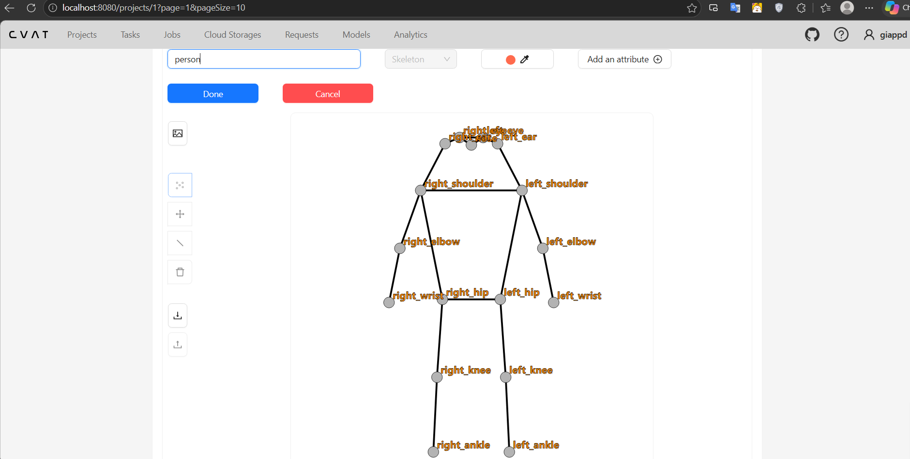
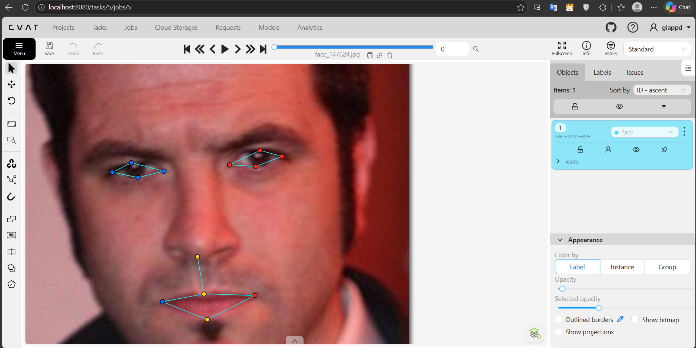
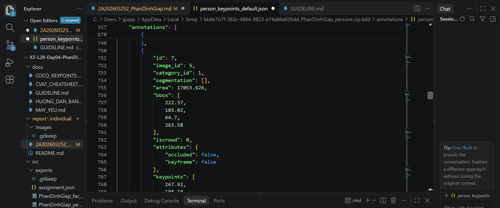

# Báo cáo cá nhân — HoVaTen-MSSV

Đổi tên file theo quy tắc `MSSV_HoTen.md`. Ví dụ: `20241234_NguyenVanAn.md`.

Dữ liệu: 12 ảnh người COCO val2017 (Lin et al., 2014) và 8 ảnh chân dung Wikimedia Commons, chỉ dùng trong lớp.

## 0. Thông tin học viên

- Họ tên:Phan Đình Giáp
- MSSV:2A202603252
- Email:giappdhe140952@gmail.com
- Link repository:https://github.com/giappd-ai/K5-L2B-Day04-PhanDinhGiap-2A202603252-KeypointPose-Student.git
- Phiên bản CVAT (Help → About):CVAT 2.82
- Máy: hệ điều hành window · RAM 16 GB · chạy CVAT chế độ đầy đủ 
- Giờ bắt đầu:17h30
- Giờ kết thúc:24h00

## 1. Kiểm tra label (CP0)

| Label | Kiểu | Số điểm | Tên điểm đúng bảng của lab? | Đúng thứ tự? | Số cạnh |
|---|---|---:|---|---|---:|
| `person` |Skeleton |17 |Có | Có |19
| `face` | Skeleton| |13 |Có |Có|13

Mẫu `person` dựng theo người quay mặt về camera (các điểm `left_*` nằm bên phải khung mẫu)? Có / Không
Có

Cách đổi cờ `occluded` / `outside` cho **một điểm** trên phiên bản CVAT này (một câu):

Click chuột phải vào điểm cần đổi trên giao diện gán nhãn, chọn menu trạng thái tương ứng (`occluded` hoặc `outside` , Q / O	occluded / outside (rê vào điểm) ).

## 2. Số lượng đã gán và thời gian (CP1, CP2)

| Nhóm ảnh | Số ảnh | Số skeleton đã gán | Số người dưới 60 px (không gán) | Số poster / gương / màn hình bỏ qua | Thời gian (phút) |
|---|---:|---:|---:|---:|---:|
| `easy` | 5 | 5| 0| 0| 25|
| `occluded` | 3 |3 |0 |0 | 20|
| `back` | 2 |2 |0 |0 | 15|
| `small` | 1 | 0|1 | 0|5 |
| `crowd` | 1 | 3|0 |0 |20 |
| `faces` | 8 | 8| — | 0| 20|

- Số ảnh người đã xong ở mốc phút 105: __10_ / 10
- Thời gian thực tế (phút): CP1 45 · CP2 40 · CP3 20
- Ảnh tốn thời gian nhất là ảnh nào, vì sao?
Ảnh 000000522889.jpg thuộc nhóm `crowd` 
Lý do ảnh này chứa nhiều người che khuất lẫn nhau trong một không gian đông đúc, đòi hỏi phải lần theo từng chi tiết xương khớp xuất phát từ vai và hông của từng cá nhân để tránh tình trạng vắt chéo xương sang người khác hoặc nhầm lẫn cờ trái/phải (lr_swap).
...

## 3. Bảng ca khó (CP1, CP2)

Mỗi điểm bạn phân vân một dòng, nhất là phân vân giữa `v = 1` và `v = 0`, hoặc không chắc hướng người.

| Ảnh | Người / mặt | Điểm | Cờ đã chọn | Phân vân giữa | Lý do chọn |
|---|---|---|---:|---|---|
|000000043968.jpg |Person 1 |`left_knee` | 1| v = 1 và v = 0|Khớp gối bị khuất một phần dưới trang phục nhưng vẫn ước lượng được vị trí chính xác dựa vào đoạn đùi và cổ chân lân cận |
|000000106051.jpg |Person 2 | `right_ear`|1 | v = 1 và v = 0| Tai bị che một phần bởi góc nghiêng đầu, tuy nhiên cấu trúc đối xứng giúp xác định độ tin cậy cao|
|000000193879.jpg |Person 2 |`right_ankle` | 1|v = 1 và v = 0 |Cổ chân bị che khuất nhẹ bởi góc chụp nhưng vị trí tương đối rõ qua hình dáng cẳng chân |

## 4. Bảng tự review (CP3)

Đi từ ảnh cuối về ảnh đầu. 5 ảnh người (ít nhất 2 ảnh `back` hoặc `crowd`) và 3 ảnh mặt. Ít nhất 8 dòng, kể cả dòng `ok`. Ghi lỗi trước, sửa sau.

Mã lỗi dùng đúng một trong: `lr_swap`, `vis_flag`, `position`, `missing`, `extra`, `ok`.

| Ảnh | Người / mặt | Điểm | Mã lỗi | Ghi chú | Đã sửa? |
|---|---|---|---|---|---|
|000000043968.jpg |Person 1 | `left_knee`| `lr_swap`|Nhầm chân trái và chân phải do người quay nghiêng. |Đã sửa |
|000000106051.jpg| Person 2 |`right_ear` | `lr_swap`|Cặp tai bị ngược chiều so với các cặp điểm còn lại. |Đã sửa|
|000000193879.jpg | Person 2|`right_ankle` |`lr_swap` |Nhầm cổ chân trái/phải do góc nhìn. | Đã sửa|
|000000522889.jpg | Person 3|`right_ankle` | `lr_swap`| Cặp cổ chân nằm ngược phía|Đã sửa |
|000000314154.jpg|Person 1 | `left_shoulder`| `ok`| Vị trí chuẩn xác, cờ đúng.| Không cần|
|face_147624.jpg | Face 1 | |mouth_left` |`ok` | Vị trí chính xác, cờ đúng.| Không cần|
|face_232598.jpg|Face 1 |`lip_upper`| `ok`| Vị trí chính xác, cờ đúng.|  Không cần|
|face_249336.jpg|Face 1 |`left_eye_upper` | `ok`|Vị trí chính xác, cờ đúng. | Không cần |

Tổng hợp số lỗi theo mã:

| `lr_swap` | `vis_flag` | `position` | `missing` | `extra` | `ok` |
|---:|---:|---:|---:|---:|---:|
| 4|0 |0 |0 |0| 4|

Điểm còn phân vân giữa `v = 1` và `v = 0` (ghi cả hai lựa chọn và lý do chọn):

Các điểm khớp bị khuất ở góc quay phức tạp được chọn `v = 1` vì vẫn có thể ước lượng chắc chắn thông qua các điểm khớp lân cận và tính đối xứng cơ thể.

## 5. Kiểm file xuất và kết quả tự kiểm (CP4)

Tự kiểm tay trong file JSON:

| File | Người / mặt kiểm (ảnh, thứ tự) | Số phần tử `keypoints` | Điểm `outside` ra `v = 0`, `occluded` ra `v = 1`? | `num_keypoints` khớp? |
|---|---|---:|---|---|
| `PhanDinhGiap_persons.zip` | 000000043968.jpg,Person 1 |51|Có | Có|
| `PhanDinhGiap_persons.zip` |000000106051.jpg, Person 2 |51 |Có |Có |
| `PhanDinhGiap_faces.zip` |face_147624.jpg,Face 1 | 39|Có |Có |

Sau khi xuất, CVAT ghi `occluded` thành `v = 1` và `outside` thành `v = 0`. Tọa độ của điểm `outside` trong file là `0, 0` hay tọa độ cũ? Tọa độ cũ

Hai job đã chuyển sang completed trên CVAT? Có 

Dán phần **TÓM TẮT** in ra từ `src/check_submission.py`:

```text
- File person: PhanDinhGiap_persons.zip
  Số ảnh: 12 · số skeleton `person`: 20 · mỗi annotation 51 số
  Skeleton theo ảnh: 000000043968=1, 000000054909=2, 000000106051=2, 000000175703=1, 000000193879=2, 000000314154=1, 000000324953=2, 000000360811=2, 000000365099=1, 000000399983=1, 000000431988=2, 000000522889=3
  Cờ v: v=2 281 (83%) · v=1 11 (3%) · v=0 48 (14%)
  num_keypoints trung bình: 14.6
- File face: PhanDinhGiap_faces.zip
  Số ảnh: 8 · số skeleton `face`: 8 · mỗi annotation 39 số
  Skeleton theo ảnh: face_147624=1, face_232598=1, face_249336=1, face_301643=1, face_333134=1, face_415073=1, face_416730=1, face_496353=1
  Cờ v: v=2 104 (100%) · v=1 0 (0%) · v=0 0 (0%)
  num_keypoints trung bình: 13.0
- Ghi chú: 48 điểm v = 0 vẫn mang tọa độ cũ (CVAT 2.x xuất như vậy; chuẩn COCO ghi 0, 0). Không phải lỗi: điểm v = 0 bị bỏ qua khi huấn luyện và khi chấm.
- Số [LỖI]: 0 · số [CẢNH BÁO]: 4
Kết quả: ĐẠT (đọc lại từng cảnh báo ở trên)
```

Các `[CẢNH BÁO]` còn giữ nguyên và lý do:

Các cảnh báo lr_swap xuất hiện do tư thế vận động viên hoặc góc quay nghiêng có hiện tượng chân/tai bắt chéo thực tế. Sau khi kiểm tra lại, vị trí gán nhãn đã chính xác theo đúng hướng người trong ảnh nên giữ nguyên cấu trúc này.

## 6. Ảnh chụp màn hình

1. Label `person` trong label constructor (đủ 17 điểm có tên):

   

2. Một người quay lưng đã gán, cờ đã đặt:

   

3. Một khuôn mặt đã gán 13 điểm, phóng to vùng mắt:

   

4. Một đoạn JSON xuất của một người:

   

Nguồn ảnh: COCO val2017 / Wikimedia Commons.

## 7. Tự đánh giá

1. Lỗi bạn mắc nhiều nhất hôm nay, và cách bạn sẽ tránh ở dự án thật:

   ...

2. Một quy tắc bạn đề xuất thêm vào guideline (kèm ảnh ví dụ nếu có):

   ...

3. Nhãn của bạn đi vào model ở đâu? Chọn một lỗi bạn đã sửa và nói nó sẽ làm model học sai thế nào (heatmap, trọng số trong loss, hay bước lật ảnh):

   ...

## 8. Khó khăn và lỗi kỹ thuật

...

## Bonus (nếu làm)

### B1 — 3 ảnh người khó thêm

| Ảnh | Số skeleton | Số người dưới 60 px | Ca khó nhất |
|---|---:|---:|---|
| | | | |
| | | | |
| | | | |

Kết quả `src/check_submission.py` cho `HoVaTen_bonus_persons.zip`:

```text
(dán ở đây)
```

### B2 — 5 ảnh khuôn mặt đen trắng / hồng ngoại

Ảnh không màu khó hơn ở điểm nào? Kính râm trên ảnh hồng ngoại có còn là `v = 1` không?

...

### B3 — Model so với nhãn của tôi (không tính điểm)

- Demo đã dùng:
- Ảnh đã thử:

1. Model có trả điểm cho khớp bị che, hay khớp ngoài ảnh không? Confidence ở các điểm đó thế nào?

   ...

2. Với người quay lưng, model có đổi trái/phải không?

   ...

3. Bộ điểm của model có giống 17 điểm COCO không?

   ...

## 9. Tài liệu tham khảo và công cụ AI đã dùng

...
